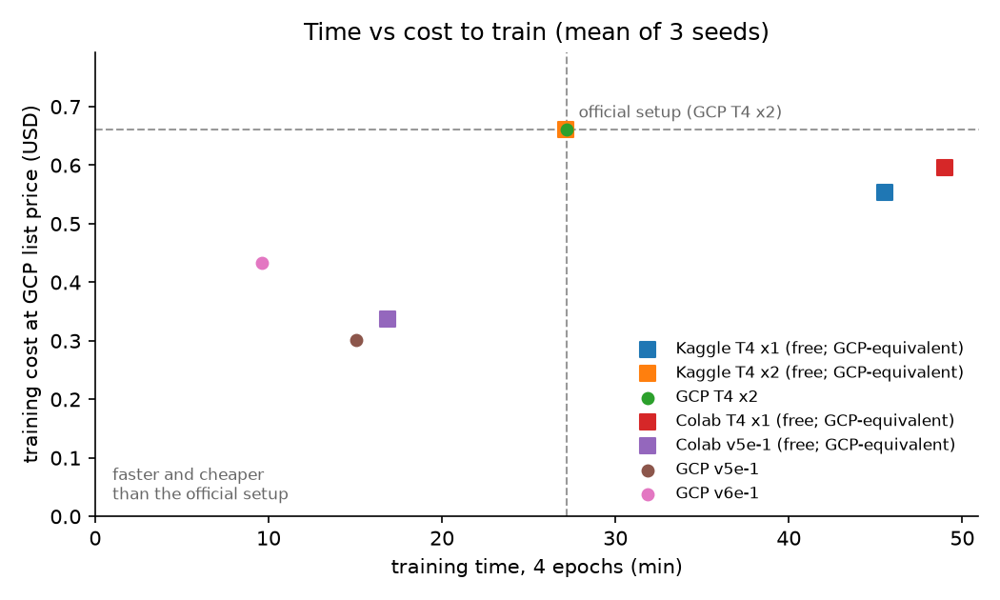

# Laya on TorchTPU

[English](README.md) 

[Laya](https://github.com/NandhaKishorM/laya)의 파인튜닝 노트북을 [TorchTPU](https://github.com/google-pytorch/torch_tpu) 0.2.0로 재작성

## 빠른 시작 (Colab, TPU v5e-1)

[](https://colab.research.google.com/github/oikosohn/decision-models-torchtpu/blob/main/laya/notebooks/laya_finetune_typed_decisions_v5e1_colab.ipynb)

절차
1. [`notebooks/laya_finetune_typed_decisions_v5e1_colab.ipynb`](notebooks/laya_finetune_typed_decisions_v5e1_colab.ipynb)를
 Colab에서 열기
2. 런타임 → 런타임 유형 변경 → **v5e-1 TPU**
3. 런타임 → 모두 실행
4. 설치 후 Colab이 런타임을 재시작 → 런타임 → 모두 실행

주의 
- 학습은 약 17분, 노트북 전체는 약 27분 소요
- Hub 업로드 비활성화
- 체크포인트를 저장하려면 `NEW_REPO` 지정, Colab Secret에 `HF_TOKEN` 추가, `PUSH = True` 설정 필요

## 변경 내역

변경한코드는 `# TorchTPU:` 주석을 표시함

| 변경 항목 | 사유 | 비교 (공식 → TorchTPU) |
|---|---|---|
| 디바이스, 프로세스 그룹 | TPU 칩마다 프로세스 하나로 실행 | nccl, cuda → tpu_dist, tpu |
| DDP, 컴파일 | TPU는 XLA로 컴파일해 실행 | DDP(device_ids=…) → DDP + torch.compile(backend="tpu") |
| 정밀도 | bf16 autocast가 nn.LayerNorm에서 실패함([#5678](https://github.com/google-pytorch/torch_tpu/issues/5678)). fp32 행렬곱도 기본 정밀도에서는 bf16으로 연산함 | fp16 autocast + GradScaler → fp32 |
| 고정 형태 | 입력 형태가 바뀔 때마다 재컴파일함 | 가변 길이 → 길이 128 단위 · 옵션 수 최대값으로 패딩, 마지막 부분 마이크로배치는 복사본으로 채우고 손실에서 제외 |
| 그래디언트 누적 | 칩 수와 관계없이 유효 배치 64 유지 | 4 고정 → 64 // (8 × 칩 수) |
| rank 0 대기 | TPU 슬라이스는 워커가 먼저 종료하면 전체가 중단됨 | rank 0 저장 후 각자 종료 → 다른 rank가 .rank0_done 파일 대기 |
| 어텐션 마스크 | 0.2.0이 쿼리 차원 브로드캐스트 SDPA 마스크를 잘못 처리함([#5677](https://github.com/google-pytorch/torch_tpu/issues/5677)) | [B, 1, 1, S] 마스크 → expand_sdpa_query_broadcast()로 펼침 |
| 실행 | TPU 런타임 설정을 torchrun에 전달 | torchrun --nproc_per_node=2 → torch.tpu.distributed 설정 + torchrun |
| 평가 | 사례마다 형태가 달라 사례 대부분을 컴파일함 | 공식 루프 → bucket_agent(v5e-1 257초 → 57초, v6e-1 305초 → 35초) |
| 버전 고정 | GPU와 TPU에서 같은 버전 사용 | torch 2.14.1, torch_tpu 0.2.0, laya 0.4.17, transformers 5.21.0 |

## 결과

시드 42, 43, 44의 평균 ± 표준편차입니다. 
- 전체 실행 기록 : [results/runs.csv](results/runs.csv)
- 결과 요약 : [results/summary.md](results/summary.md).


| 실행                   | 속도  | 학습 시간 | 최대 메모리  | 테스트 정확도       | 평가 시간 ² | 학습 비용 ¹   | 100만 시퀀스당 USD ¹ |
| -------------------- | ---------: | --------: | -------: | -------------: | ---------: | ---------: | ---------------: |
| GCP T4 2장 (공식)       | 1.00배     | 27분      | 10.0 GB | 0.743 ± 0.043 | 55 ± 4초   | $0.66     | $29.3           |
| Kaggle T4 2장 (공식)    | 0.99배     | 27분      | 10.0 GB | 0.735 ± 0.064 | 52 ± 2초   | ($0.66)   | ($29.4)  |
| Kaggle T4 1장 (공식)    | 0.59배     | 46분      | 10.0 GB | 0.773 ± 0.008 | 54 ± 3초   | ($0.55)   | ($24.8)  |
| Colab T4 1장 (공식)     | 0.58배     | 49분      | 10.0 GB | 0.772 ± 0.003 | 55 ± 3초   | ($0.60)   | ($25.2)  |
| Colab TPU v5e-1 (포팅) | 2.25배     | 17분      | 16.7 GB | 0.769 ± 0.004 | 60 ± 0초   | ($0.34)   | ($10.7)  |
| GCP TPU v5e-1 (포팅)   | **2.31배** | 15분      | 16.7 GB | 0.772 ± 0.003 | 57 ± 0초   | **$0.30** | **$10.4**       |
| GCP TPU v6e-1 (포팅)   | **4.48배** | 10분      | 19.5 GB | 0.770 ± 0.008 | 35 ± 0초   | $0.43     | $12.1           |


¹ Kaggle과 Colab은 무료이며, 괄호는 GCP 온디맨드 정가를 의미함.

² 평가는 학습 시간과 비용에 포함되지 아니함. TPU 코드는 bucket_agent로 평가함.



- TPU 에포크 시간은 시드 간에 거의 일정하나 에포크 1은 컴파일이 포함되어 약 170–290초 더 소요됨.
- 공식 노트북은 torch 난수를 고정하지 않아서 실행마다 정확도가 다름.
- original_t4x1 는 그래디언트 누적을 8로 변경함.

## 구성

```
notebooks/            TPU 런타임 노트북
notebooks/baselines/  GPU 런타임 노트북
upstream/             공식 노트북(Laya v0.4.8, 커밋 4ac226d)
results/              runs.csv, summary.md, figures/
```

```bash
python results/plot.py    # runs.csv로 summary.md와 그림(figures/) 다시 생성
```

## 라이선스

[Apache-2.0](LICENSE)

- [Convai Innovations](https://huggingface.co/convaiinnovations) : 모델, 노트북, Typed-Decisions 벤치마크 출처