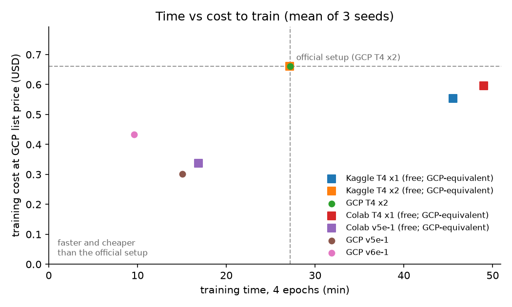

# Laya on TorchTPU

[한국어](README.ko.md)

The [Laya](https://github.com/NandhaKishorM/laya) fine-tuning notebook, rewritten for [TorchTPU](https://github.com/google-pytorch/torch_tpu) 0.2.0.

## Quick start (Colab, TPU v5e-1)

[](https://colab.research.google.com/github/oikosohn/decision-models-torchtpu/blob/main/laya/notebooks/laya_finetune_typed_decisions_v5e1_colab.ipynb)

Steps
1. Open [`notebooks/laya_finetune_typed_decisions_v5e1_colab.ipynb`](notebooks/laya_finetune_typed_decisions_v5e1_colab.ipynb)
 in Colab.
2. Runtime → Change runtime type → **v5e-1 TPU**.
3. Runtime → Run all.
4. After the install, Colab restarts the runtime → Runtime → Run all.

Notes
- Training takes about 17 minutes; the whole notebook about 27.
- The Hub upload is off.
- To save the checkpoint, set `NEW_REPO`, add `HF_TOKEN` to Colab Secrets, and set `PUSH = True`.

## Changes

Changed code is marked with a `# TorchTPU:` comment.

| Change | Reason | Comparison (official → TorchTPU) |
|---|---|---|
| Device, process group | One process per TPU chip | nccl, cuda → tpu_dist, tpu |
| DDP, compilation | TPU runs through XLA compilation | DDP(device_ids=…) → DDP + torch.compile(backend="tpu") |
| Precision | bf16 autocast fails on nn.LayerNorm ([#5678](https://github.com/google-pytorch/torch_tpu/issues/5678)). At the default precision, fp32 matmuls also run as bf16 | fp16 autocast + GradScaler → fp32 |
| Fixed shapes | Every new input shape triggers a recompile | Variable lengths → padded to lengths in steps of 128 · to the maximum option count; a partial last micro-batch is filled with copies that the loss leaves out |
| Gradient accumulation | Keeps the effective batch at 64 for any chip count | Fixed 4 → 64 // (8 × chips) |
| Rank 0 wait | On a TPU slice, a worker that exits early aborts the whole slice | Rank 0 saves, each rank exits on its own → the other ranks wait for a .rank0_done file |
| Attention mask | 0.2.0 mishandles an SDPA mask broadcast over the query dimension ([#5677](https://github.com/google-pytorch/torch_tpu/issues/5677)) | [B, 1, 1, S] mask → expanded by expand_sdpa_query_broadcast() |
| Launch | Passes the TPU runtime settings to torchrun | torchrun --nproc_per_node=2 → torch.tpu.distributed settings + torchrun |
| Evaluation | Each case has its own shape, so most cases compile | Official loop → [bucket_agent](notebooks/laya_finetune_typed_decisions_v5e1_colab.ipynb). v5e-1 257 s → 57 s, v6e-1 305 s → 35 s |
| Version pins | The same versions on GPU and TPU | torch 2.14.1, torch_tpu 0.2.0, laya 0.4.17, transformers 5.21.0 |

## Results

Mean ± std over seeds 42, 43 and 44.
- Full run records: [results/runs.csv](results/runs.csv)
- Results summary: [results/summary.md](results/summary.md)


| Run                       | vs 2× T4   | Train, 4 epochs | Peak memory | Test accuracy  | Eval, 400 cases ² | Training cost ¹ | USD per 1M seq ¹ |
| ------------------------- | ---------: | --------------: | ----------: | -------------: | ----------------: | --------------: | ---------------: |
| GCP 2× T4 (official)      | 1.00×      | 27 min          | 10.0 GB     | 0.743 ± 0.043  | 55 ± 4 s          | $0.66           | $29.3            |
| Kaggle 2× T4 (official)   | 0.99×      | 27 min          | 10.0 GB     | 0.735 ± 0.064  | 52 ± 2 s          | ($0.66)         | ($29.4)         |
| Kaggle 1× T4 (official)   | 0.59×      | 46 min          | 10.0 GB     | 0.773 ± 0.008  | 54 ± 3 s          | ($0.55)         | ($24.8)         |
| Colab 1× T4 (official)    | 0.58×      | 49 min          | 10.0 GB     | 0.772 ± 0.003  | 55 ± 3 s          | ($0.60)         | ($25.2)         |
| Colab TPU v5e-1 (port)    | 2.25×      | 17 min          | 16.7 GB     | 0.769 ± 0.004  | 60 ± 0 s          | ($0.34)         | ($10.7)         |
| GCP TPU v5e-1 (port)      | **2.31×**  | 15 min          | 16.7 GB     | 0.772 ± 0.003  | 57 ± 0 s          | **$0.30**       | **$10.4**        |
| GCP TPU v6e-1 (port)      | **4.48×**  | 10 min          | 19.5 GB     | 0.770 ± 0.008  | 35 ± 0 s          | $0.43           | $12.1            |


¹ Kaggle and Colab are free; values in parentheses are GCP on-demand list prices.

² Evaluation is not included in the training time or cost. The TPU code evaluates with bucket_agent.



- TPU epoch times are nearly constant across seeds, but epoch 1 includes compilation and takes about 170–290 s longer.
- The official notebook does not seed torch's RNG, so accuracy varies between runs.
- original_t4x1 changes the gradient accumulation to 8.

## Layout

```
notebooks/            TPU runtime notebook
notebooks/baselines/  GPU runtime notebooks
upstream/             the official notebook (Laya v0.4.8, commit 4ac226d)
results/              runs.csv, summary.md, figures/
```

```bash
python results/plot.py    # rebuild summary.md and the figures from runs.csv
```

## License

[Apache-2.0](LICENSE)

- [Convai Innovations](https://huggingface.co/convaiinnovations): source of the model, the notebook and the Typed-Decisions benchmark
