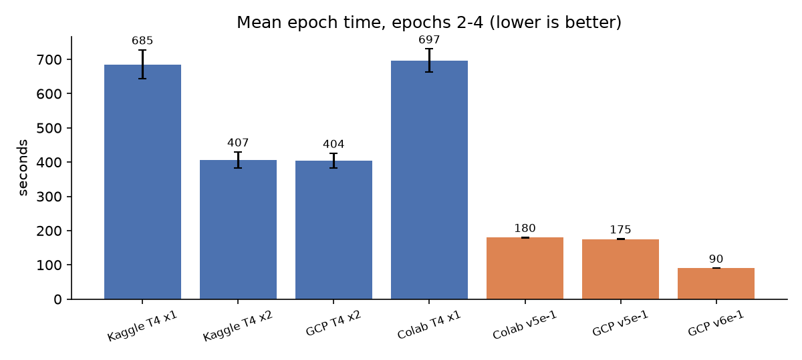
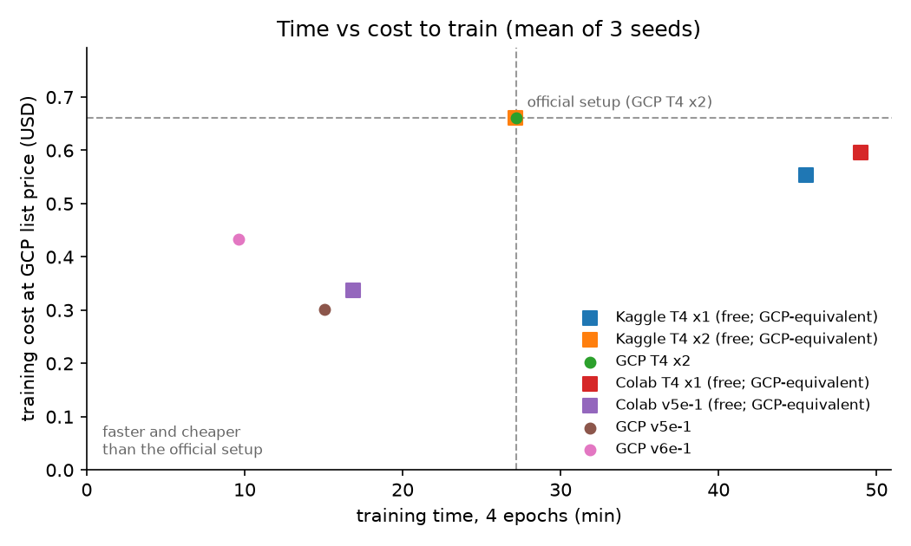
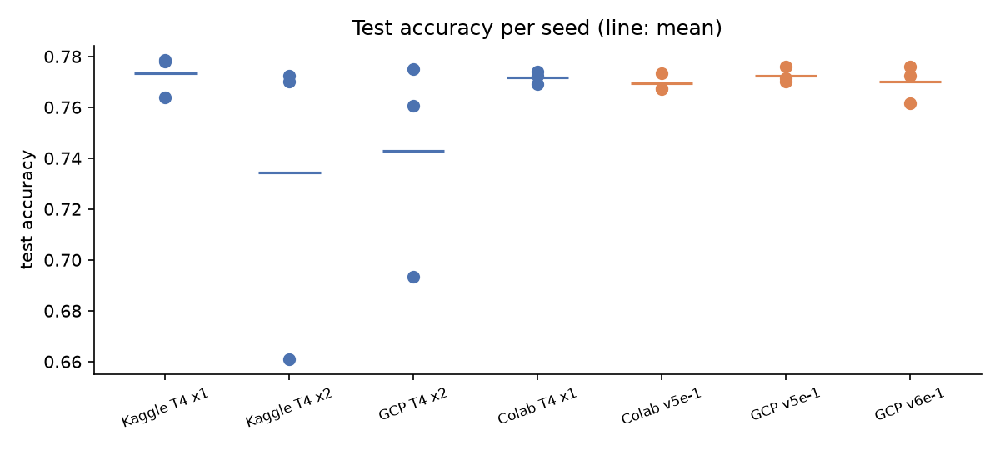
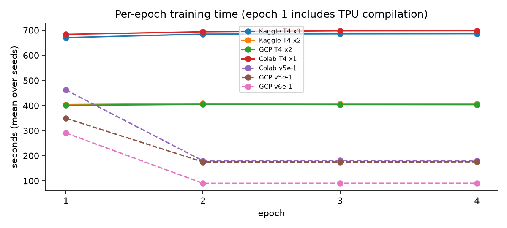

# Results

Generated by [`plot.py`](plot.py) from [`runs.csv`](runs.csv). Mean ± sample std over seeds 42, 43, 44. TPU rows evaluate with fixed shapes, GPU rows with the official loop. Costs are GCP on-demand list prices; Kaggle and Colab runs are free, and their costs, in parentheses, are what the same hardware costs on GCP.

| Configuration | Mean epoch, 2-4 (s) | Speed-up | Train, 4 epochs (s) | Peak memory (GB) | Accuracy | Brier | ECE | Eval, 400 cases (s) | Training cost (USD) | USD per 1M seq |
|---|---:|---:|---:|---:|---:|---:|---:|---:|---:|---:|
| Kaggle T4 x1 | 685.4 ± 42.6 | 0.59x | 2732 ± 159 | 10.02 ± 0.00 | 0.773 ± 0.008 | 0.052 ± 0.001 | 0.148 ± 0.007 | 54 ± 3 | (0.55 ± 0.03) | (24.8 ± 1.5) |
| Kaggle T4 x2 | 406.6 ± 23.3 | 0.99x | 1629 ± 94 | 10.02 ± 0.00 | 0.735 ± 0.064 | 0.071 ± 0.031 | 0.133 ± 0.018 | 52 ± 2 | (0.66 ± 0.04) | (29.4 ± 1.7) |
| GCP T4 x2 | 404.0 ± 21.8 | 1.00x | 1632 ± 84 | 10.02 ± 0.00 | 0.743 ± 0.043 | 0.065 ± 0.023 | 0.130 ± 0.019 | 55 ± 4 | 0.66 ± 0.03 | 29.3 ± 1.6 |
| Colab T4 x1 | 696.7 ± 34.1 | 0.58x | 2938 ± 156 | 10.02 ± 0.00 | 0.772 ± 0.003 | 0.050 ± 0.001 | 0.146 ± 0.002 | 55 ± 3 | (0.60 ± 0.03) | (25.2 ± 1.2) |
| Colab v5e-1 | 179.6 ± 0.6 | 2.25x | 1011 ± 4 | 16.73 ± 0.00 | 0.769 ± 0.004 | 0.050 ± 0.001 | 0.142 ± 0.003 | 60 ± 0 | (0.34 ± 0.00) | (10.7 ± 0.0) |
| GCP v5e-1 | 175.2 ± 0.8 | 2.31x | 903 ± 5 | 16.72 ± 0.02 | 0.772 ± 0.003 | 0.052 ± 0.000 | 0.141 ± 0.002 | 57 ± 0 | 0.30 ± 0.00 | 10.4 ± 0.0 |
| GCP v6e-1 | 90.1 ± 0.2 | 4.48x | 578 ± 6 | 19.52 ± 0.03 | 0.770 ± 0.008 | 0.053 ± 0.003 | 0.140 ± 0.013 | 35 ± 0 | 0.43 ± 0.01 | 12.1 ± 0.0 |

